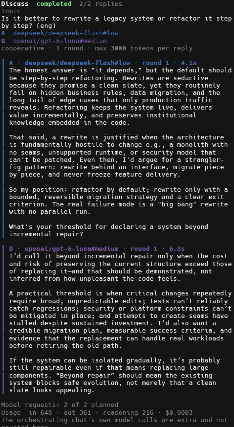
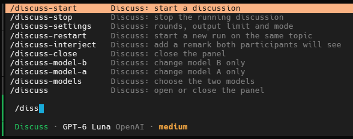

# opencode-discuss

[](https://github.com/thejohnd0e/opencode-discuss/actions/workflows/build.yml)
[](LICENSE)
[](https://opencode.ai)
[](https://www.typescriptlang.org)
[](https://bun.sh)
[](https://www.python.org)

**A two-model discussion mode for [OpenCode](https://opencode.ai).** Pick two
models, give them a topic, and watch them discuss it in a colour-coded live panel
inside the terminal UI. Step in with a remark, change the topic, or stop the run,
then hand the result to the **Plan** or **Build** agent.

<p align="center">
  
</p>

- **Two voices, one panel.** Model A and model B take turns; every reply is
  labelled and coloured by side, and streams in word by word.
- **Three modes.** Cooperative, critical and debate.
- **You stay in control.** Starting always asks for your confirmation, the output
  cap and round count are explicit, and `/discuss-stop` ends the run at once.
- **Honest accounting.** The panel shows the requests made against the plan and the
  tokens and cost OpenCode reported, or says `unknown`.
- **Hand-off.** Send the discussion's outcome to Plan or Build, once, with a
  preview and a confirmation.
- **Safe to leave installed.** Nothing patches OpenCode: it is a normal plugin
  (server part, TUI part, typed RPC contract) plus two agent files.

> **Cost warning.** Every discussion calls two paid models. The panel and the
> start dialog show the worst-case number of calls and output tokens up front,
> but input and reasoning tokens and the orchestrating chat cost extra. Read
> [Limits](#limits).

## Contents

[How it works](#how-it-works) · [Build](#build) · [Install](#install) ·
[Use](#use) · [Limits](#limits) · [Tests](#tests) · [Troubleshooting](#troubleshooting) ·
[Known limitations](#known-limitations) · [Documentation](#documentation) · [License](#license)

## Requirements

- OpenCode 2.2.5 (the only version this build was verified against)
- Python 3.12 for the dialogue engine
- Bun 1.4+ to build the plugin
- Two enabled chat models in OpenCode; authentication stays inside OpenCode

## How it works

- `src/server.ts` owns runs, durable state and provider calls. It registers the
  `discuss` RPC methods and the `discuss_*` tools.
- `src/tui.ts` is a view/controller only. It subscribes to RPC events, shows the
  panel and sends commands. Closing the panel does not stop a run.
- `scripts/discuss-runner.py` imports the unchanged engine in
  `scripts/model-duel.py`, builds role-tagged prompts and asks the server to
  perform each turn. The server creates a hidden tool-less session per turn,
  replaces its messages through the supported `context` hook, streams deltas to
  the panel and interrupts it on stop.
- State lives in plugin storage, one key per location, and the TUI sends each
  call to the session's own location; transcripts and handoff packets also go to
  `%LOCALAPPDATA%\opencode-discuss` (or `$XDG_STATE_HOME`).
- `agents/discuss.md` is the primary agent that makes the mode selectable next
  to Plan and Build.

## Build

```sh
bun install
bun run build
bun run typecheck
bun test
python -m unittest discover -s tests -p "test_*.py"
```

`dist/` is not committed; build before installing.

## Install

A package with a server part belongs in `opencode.json(c)`, not `cli.json`:

```jsonc
{
  "$schema": "https://opencode.ai/config.json",
  "plugins": [
    { "package": "D:/path/to/opencode-discuss", "options": { "python": "python" } }
  ]
}
```

If an older TUI-only entry for this plugin exists in
`~/.config/opencode/cli.json`, remove that entry after adding the package to
`opencode.json`; loading both would duplicate the TUI part. Back up both files
first.

Copy the agent definition next to your other agents:

```sh
mkdir -p ~/.config/opencode/agents
cp agents/discuss.md ~/.config/opencode/agents/discuss.md
cp agents/discuss-participant.md ~/.config/opencode/agents/discuss-participant.md
```

OpenCode reloads configuration after a save; use `/reload` if needed.

## Use

1. Select **Discuss** in the agent selector.
2. Run `/discuss-models` and pick model A, model B, then confirm the pair.
3. Send a topic in chat, or run `/discuss-start <topic>`. Either way the start
   asks for your confirmation, and the panel opens by itself once it starts.
4. Watch the panel, stop or interject, then hand the result to Plan or Build
   with an explicit confirmation.

Type `/discuss` in the prompt to list the commands:



| Action | Command | Key |
| --- | --- | --- |
| Open or close the panel | `/discuss` (or `/discuss-close`) | — |
| Start a discussion | `/discuss-start [topic]` | — |
| Choose the two models | `/discuss-models` | — |
| Choose both by name | `/discuss-models <A> <B>` | — |
| Change only A / only B | `/discuss-model-a <A>`, `/discuss-model-b <B>` | — |
| Rounds, output limit, mode | `/discuss-settings rounds=1 tokens=300 mode=critical` | — |
| Stop | `/discuss-stop` | `ctrl+shift+x`* |
| Interject | `/discuss-interject <text>` | `ctrl+shift+i`* |
| Change topic | `/discuss-topic <text>` | `ctrl+shift+t`* |
| New run, same topic | `/discuss-restart` | `ctrl+shift+r`* |
| Hand off | `/discuss-handoff` | `ctrl+shift+h`* |

\* Many terminals, including Windows Terminal by default, send
`ctrl+shift+<letter>` as `ctrl+<letter>`, and `ctrl+x` is OpenCode's leader key.
Use the slash commands or the palette (`ctrl+p`), which always work.

### Choosing models by command

A model reference is `provider/model`, `provider:model`, optionally with
`#variant` (case does not matter), or any fragment of the id or display name
that matches exactly one enabled model.

```text
/discuss-models provider-x/model-one provider-y/model-two
/discuss-models model-one              # A by fragment, B from the list
/discuss-model-b provider-y:model-two#high   # change B, keep A
```

- Both sides typed: saved immediately, no dialog.
- A side left out, a fragment that matches several models, or a model with
  variants typed without one: the selector opens (narrowed to the matches) and
  the pair is confirmed at the end.
- A disabled or unknown model is refused with a message; nothing is substituted.
- `/discuss-model-a` and `/discuss-model-b` keep the other side only when a pair
  is already saved.

Selecting models never starts generation; starting a discussion still shows its
own confirmation.

`/discuss-settings` without arguments shows the current pair and limits. With
`rounds=1..12`, `tokens=16..32000` or `mode=cooperative|critical|debate` it
changes them and keeps the models. Any invalid key refuses the whole change. In
a session without a pair it first offers the previous pair (or the model
picker) and then applies the typed values on top.

Commands typed on the home screen create an empty Discuss session first (no
message, no model call).

Each session has its own pair. In a session without one, `/discuss-models`,
`/discuss-settings` and `/discuss-start` first offer the pair last used in this
project; it is applied only if you pick it.

If a typed `/discuss-start <topic>` is sent to the chat instead, it was not
recognised as a command; it usually happens when the line is pasted and sent
before the slash suggestion is selected. Run `/discuss-start` on its own and
enter the topic in the dialog.

## Limits

- Rounds must be between 1 and 12; the output limit must be between 16 and
  32000 tokens.
- A run makes `rounds × 2` participant calls. OpenCode's automatic
  continuation after the output limit is cut off, so each call is one model
  request; the panel shows the actual count. The worst-case participant
  output is `rounds × 2 × maxOutputTokens`.
- Input tokens, reasoning tokens, provider pricing and the orchestrating
  conversation are **not** included in that number. There is no reliable total
  cost cap. Reasoning models can spend a small output limit on reasoning before
  any visible text; the reply is then cut with a note.
- The output limit is applied as a request override. A provider may ignore it.
- After each reply the panel and the handoff show what OpenCode reported for the
  participants: input, output and reasoning tokens (reasoning is counted
  separately from output) and the cost, or `unknown` / `cost unknown` when the
  host reported nothing or the model has no price. The orchestrating chat's own
  calls are not included.
- Before a start (and before the confirmation) the saved pair is checked
  against OpenCode's model list: a missing, disabled or non-chat model, or an
  output limit above the model's own, is refused with a message.
- One run per location at a time. Another start returns `busy`; nothing is
  queued.
- No automatic retries. Restarting OpenCode marks an unfinished run `cancelled`
  with reason `interrupted by restart`.
- `/discuss-stop` interrupts the current reply and ends the run; a dialogue
  process that does not exit within 5 seconds is killed together with its
  children.
- A result is handed off at most once, even after a restart; start a new
  discussion to hand off again.

## Statuses

`completed` requires every expected reply. A run with a missing or empty reply is
`failed`, even when earlier replies succeeded. `cancelled` means the user
stopped it or the server restarted mid-run. Partial text and the transcript are
kept in every case.

## Proxy (optional)

Some networks need an external proxy for provider traffic. This plugin has no
proxy setting and does not require one. When OpenCode itself is routed through an
application proxy such as a proxy tool, the provider calls made by the server use
that same route. Direct-HTTP mode of the Python adapter would instead originate
from the Python interpreter, so it would need its own routing rule. Local
endpoints and OpenCode IPC should stay direct. Never hardcode proxy details into
the plugin configuration.

## Tests

```sh
bun test                              # state, RPC, provider, runner, models, limits, handoff
python -m unittest discover -s tests -p "test_*.py"   # bridge protocol with a fake host
python tests/run-live.py              # isolated server-load smoke test
python tests/run-tui-smoke.py         # isolated TUI-load smoke test (setup reaches ready)
```

`tests/run-live.py` loads the plugin in a private OpenCode standalone instance and
verifies the server part reaches its ready point. It does not call a model and
does not touch your configuration or state.

## Troubleshooting

The TUI writes a journal to `%LOCALAPPDATA%\opencode-discuss\logs\tui.jsonl`
(or `$XDG_STATE_HOME/opencode-discuss/logs/tui.jsonl`). It holds one JSON line per
command, RPC call, toast, panel open/close and route change, and it keeps at
most about 2 MB. The server part writes `server.jsonl` next to it (start
consent, preflight, handoff). Topic and interjection text are never written,
only their length. Set `DISCUSS_LOG=<file>` to use another file, or
`DISCUSS_LOG=off` to disable the journal.

## Documentation

- [Architecture](docs/architecture.md): modules, one turn end to end, key decisions.
- [OpenCode 2.2.5 compatibility](docs/compatibility-2.2.5.md): the verified API surface.
- [Contributing](CONTRIBUTING.md): checks to run and ground rules.
- [Implementation plan and ledger](docs/superpowers/plans/2026-11-04-discuss-mode.md):
  the task-by-task history, including live findings.

## Known limitations

- Verified live on OpenCode 2.2.5 (Windows): full discussions through the
  server bridge, the panel with streaming replies, start from chat and from
  commands with the confirmation (also when a rule says `allow`), refusal,
  stop at a turn boundary, usage, and handoff to Plan and Build.
- Not verified live: interrupting a reply in the middle (replies were too short
  to stop by hand; covered by unit tests) and the 5-second kill of a stuck
  dialogue process.
- The orchestrating agent's own model calls are additional cost and are not
  attributed automatically.
- Resume, concurrent runs in one location and semantic synthesis of agreements
  are deliberately out of scope for this version.

## License

[MIT](LICENSE) © 2026 thejohnd0e
